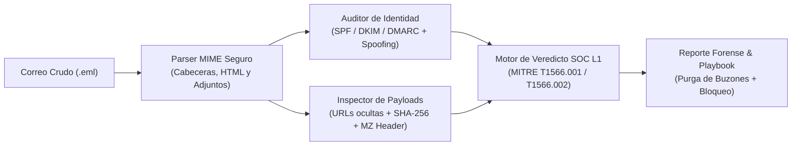

# 📧 SOC L1 Phishing Email Forensics & Triage Analyzer (`.eml`)


Analizador forense de correos electrónicos (`.eml`) y motor automatizado de **Playbook de Phishing (`MITRE ATT&CK T1566`)** diseñado para simular una de las responsabilidades más frecuentes de un **Analista SOC Nivel 1 (Tier 1)**.

---

## 🎯 ¿Qué analiza un Analista SOC L1 ante un correo reportado por Phishing?

Más del 50% de los tickets diarios en un SOC Nivel 1 provienen del buzón de *Phishing Abuse* (correos sospechosos reportados por empleados). Esta herramienta automatiza los **4 pilares del análisis forense de correo**:

1. **Autenticación de Cabeceras SMTP (`SPF`, `DKIM`, `DMARC`):**
   * Verifica si el servidor de correo que envió el mensaje estaba autorizado (`spf=pass` vs `spf=fail`), si tenía firma criptográfica válida (`dkim`) y si cumplió la política del dominio (`dmarc`).
2. **Detección de Suplantación de Identidad (*Email Spoofing*):**
   * Compara el remitente visible (`From: pagos@empresa-oficial.com`) contra el camino real de retorno (`Return-Path: bounce@mailer-darkhost.ru`) y la dirección de respuesta (`Reply-To: cobros@facturacion-urgente.xyz`).
3. **Inspección de Enlaces Engañosos (*Link Mismatch & Typosquatting*):**
   * Detecta cuando el texto visible de un enlace dice `https://login.microsoftonline.com` pero el enlace real (`href`) redirige a un dominio falso como `http://micr0soft-auth-portal.xyz` (con un cero `0` en lugar de `o`).
4. **Análisis Forense de Archivos Adjuntos (Doble Extensión + Hash SHA-256 + Magic Bytes):**
   * Detecta archivos ejecutables camuflados con doble extensión (`Factura_Pendiente_Nov2026.pdf.exe`), verifica si la cabecera binaria empieza con `MZ` (ejecutable de Windows PE) y calcula su **Hash SHA-256** en memoria sin ejecutarlo.

---

## 🏗️ Arquitectura del Analizador de Phishing



---

## 📂 Estructura del Proyecto

```text
soc-l1-phishing-email-analyzer/
├── samples/
│   ├── suspicious_invoice_phish.eml  # Muestra de Spear-Phishing con Spoofing, Link Falso y .pdf.exe
│   └── legitimate_it_notice.eml      # Muestra de correo corporativo legítimo (Falso Positivo)
├── src/
│   ├── __init__.py
│   ├── eml_parser.py                 # Extracción segura de cabeceras, enlaces HTML y hashes SHA-256
│   ├── phishing_detector.py          # Reglas heurísticas de Phishing y mapeo MITRE ATT&CK T1566
│   └── phishing_reporter.py          # Generador de reporte de triaje SOC L1 y Playbook de contención
├── reports/                          # Reportes forenses generados en Markdown y JSON
├── tests/                            # Pruebas unitarias
├── main.py                           # CLI principal de análisis de correos .eml
└── README.md
```

---

## 👤 Autor

* **Gabriel Martínez** ([@GabrielMartinez97](https://github.com/GabrielMartinez97)) — *Cybersecurity SOC L1 Portfolio*
